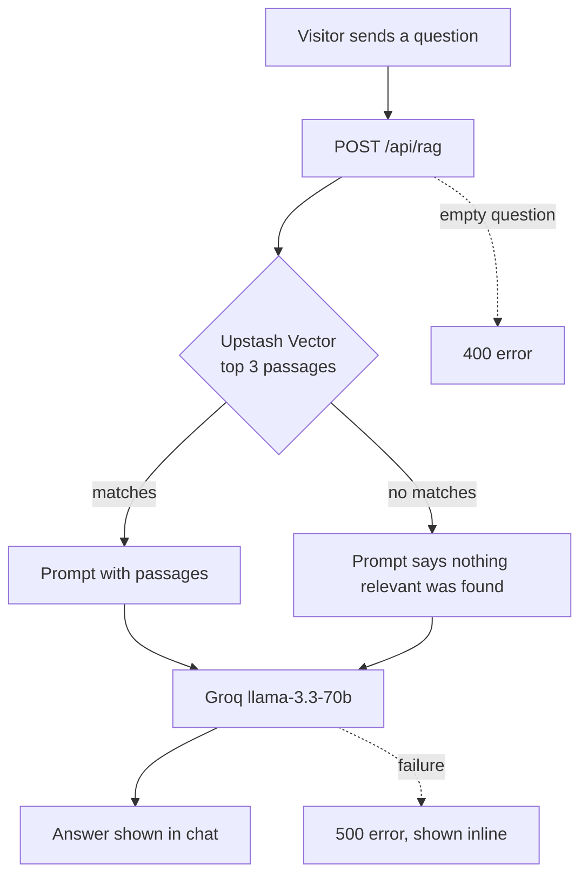
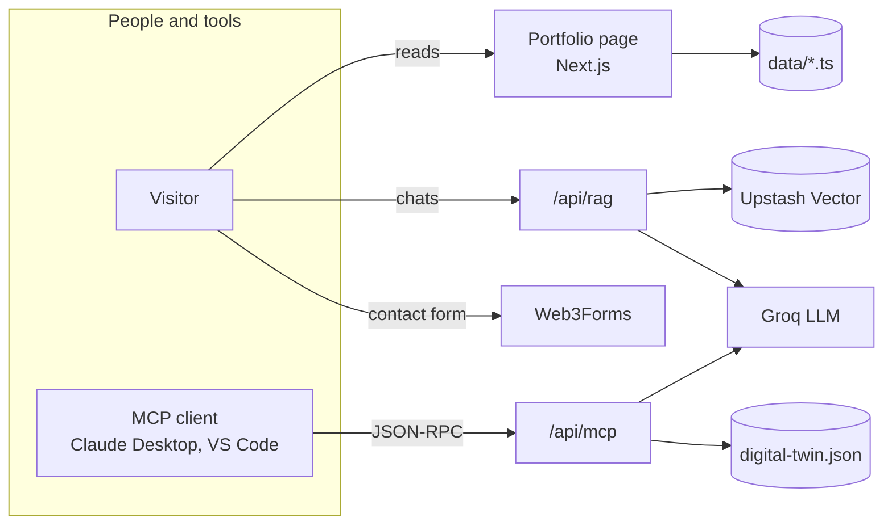
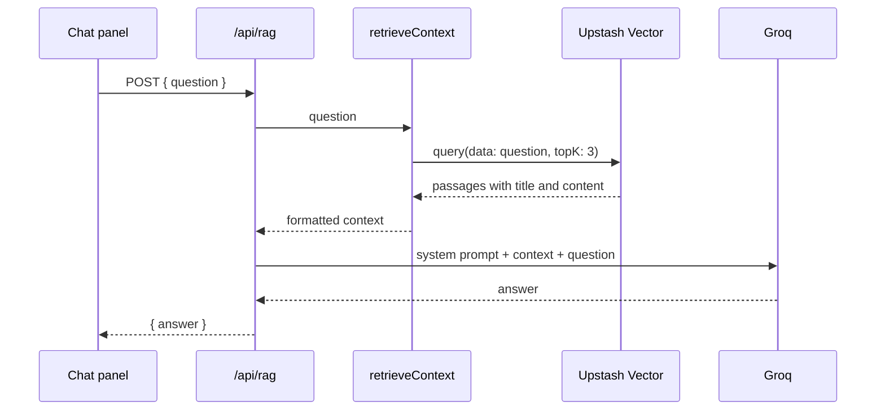
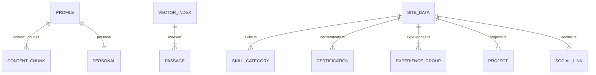

<h1 align="center">Retrieval Augmented Portfolio</h1>

### Overview

A portfolio site is usually a static page: a recruiter skims it, and any question it doesn't answer turns into an email that may never be sent. This project adds a **digital twin** to the portfolio, an AI assistant that answers questions about the owner in the first person, grounded in the owner's own profile data rather than the model's general knowledge.

The core idea is **one profile, two ways to ask**. The same digital twin answers people on the website and AI tools over the Model Context Protocol (MCP), so an assistant such as Claude Desktop or VS Code Copilot can query the profile as a tool.

The system has three parts:

- **The portfolio page** (`/`), a single scrolling page where visitors read the Home, Skills, Certifications and Training, Experience, Projects and Contact sections.
- **The chat dialog** (opened from the hero button or the floating button), where visitors ask the digital twin questions. It talks to `/api/rag`.
- **The MCP endpoint** (`/api/mcp`), where MCP clients call the digital twin as a tool.

### How It Works

A visitor's question, from typing it to reading the answer:

1. **Ask.** The visitor opens the chat dialog and sends a question. The browser posts only that question to `/api/rag`.
2. **Retrieve.** The server queries an Upstash Vector index with the raw question text. Upstash embeds it and returns the three closest profile passages.
3. **Generate.** The passages and the question go to Groq's `llama-3.3-70b-versatile` with a system prompt that tells it to answer as the owner, in the first person, concisely.
4. **Reply.** The answer is returned as JSON and added to the chat. While the request is pending, the panel shows a *Thinking* indicator, and a failure shows an inline error.

An MCP client follows a parallel path:

1. **Connect.** The client sends `initialize` and `tools/list` to `/api/mcp` and discovers two tools.
2. **Call.** `ask_digital_twin` runs a keyword search over the profile's content chunks, sends the top three to the faster `llama-3.1-8b-instant`, and returns the answer followed by the sources and their relative relevance. `get_profile_summary` returns name, title, location and contact links with no model call.

What the MVP does **not** do:

- **No conversation memory.** Each question is answered on its own. Earlier messages are shown in the panel but never sent to the model, and the chat is lost on reload.
- **No ingestion pipeline.** The vector index was filled outside this codebase. Nothing in the repo embeds or uploads passages, so the index and `data/digital-twin.json` are kept in step by hand.
- **No streaming.** Answers arrive whole.
- **No working contact form in the archived code.** The form posts straight from the browser to Web3Forms, but the access key was removed before archiving, so a submission now falls through to the error message that points to the email address.



### Architecture



Everything is one Next.js App Router project. The page itself is server-rendered from typed data modules in `data/`, with client components only where the page needs state: the chat, the mobile menu, the contact form and the scroll-reveal animations. The two route handlers are thin: they validate input and call into `lib/`, where the RAG answer, the MCP protocol handling and the Groq client live. There is no database. The only state outside the code is the Upstash index.

This is what happens when a visitor asks a question:



**Key decisions**

- **Retrieval before generation.** The model only sees the owner's own passages for each question, which keeps answers tied to real facts and keeps prompts small, instead of pasting the whole profile into every request.
- **Let the vector store do the embedding.** The index is queried with plain text (`data: question`), so the app has no embedding model, keys or code of its own.
- **Two models for two audiences.** Website visitors get the higher-quality 70B model. MCP tool calls, where another AI is the reader, use the faster and cheaper 8B model.
- **MCP without an SDK or a vector store.** The MCP server is a small hand-written, stateless JSON-RPC handler (Streamable HTTP, JSON responses only) with a weighted keyword search over the local JSON file: a title match scores 5, each word match in the text scores 2. It needs no session state and no external search, so it is cheap to host serverless and easy to unit test.
- **Content as typed data.** Skills, certifications, experiences, projects and socials are TypeScript modules rendered by section components, so updating the portfolio is a data edit, not a markup edit. Colour themes are spelled out as full class strings in `lib/theme.ts` because Tailwind only generates classes it can see literally.
- **Clients created on first use.** The Groq and Upstash clients are built lazily and read their environment variables then, failing with a clear message. The site still builds and renders without them, and only the AI routes fail.

### Domain Model

There is no database. The site content and the chatbot's knowledge come from separate sources, which is the main thing to know when reading the data:



| Concept | Meaning |
|---|---|
| Profile | `data/digital-twin.json`: the owner's structured background, plus ten prose content chunks. Read by the MCP server. |
| Content chunk | One titled passage of the profile (About Me, Technical Skills, Education, Projects Portfolio, Career Goals and so on). The unit of search. |
| Passage | A chunk stored in Upstash Vector with `title` and `content` metadata. Read by the website chatbot. |
| Site data | The typed modules in `data/` that render the visible page. Not read by either AI path. |
| Theme | A named colour set (blue, cyan and so on) that a card picks from `lib/theme.ts`. |

### Permissions

There are no accounts and no sign-in. Everything is public by design.

| Who | Can |
|---|---|
| Any visitor | Read the portfolio, chat with the digital twin, send the contact form |
| Any MCP client | Call `initialize`, `ping`, `tools/list` and `tools/call` on `/api/mcp` |

Neither AI endpoint has authentication or rate limiting, so the cost of Groq calls is bounded only by the provider's own limits.

### MCP Server and Chat Interface

**The MCP server** implements the parts of the protocol a tool-only server needs:

- `initialize` reports protocol version `2025-03-26` and a `tools` capability. `ping` returns an empty result.
- Notifications (messages with no `id`) get an empty `202`, unparseable bodies get a JSON-RPC parse error with `400`, `GET` gets `405`, and unknown methods get `-32601`.
- Tool failures come back as a normal result with `isError: true`, so the calling model can see what went wrong instead of the transport failing.

Both the protocol handler and the keyword search are covered by Vitest unit tests.

**The chat interface** is a modal dialog shared through a React context, so the hero button and the floating button open the same dialog. It closes on Escape, announces new messages through an `aria-live` log, and disables input while an answer is pending.

### Stack

| Layer | Technology |
|---|---|
| Framework | Next.js 16 (App Router, standalone output), React 19, TypeScript 5 |
| Styling | Tailwind CSS 4, Poppins, lucide-react icons |
| LLM inference | Groq (`groq-sdk` 0.36): `llama-3.3-70b-versatile` for the site, `llama-3.1-8b-instant` for MCP |
| Retrieval | Upstash Vector 1.2, with the index's built-in embedding |
| Agent interface | Model Context Protocol over Streamable HTTP, hand-written JSON-RPC |
| Contact form | Web3Forms, called from the browser |
| Tests and quality | Vitest 3, ESLint 9 |
| CI | GitHub Actions: lint, types, tests and build on every push to main and every pull request |
| Runtime | Docker image: Node 22 Alpine running the standalone server |

### Project Map

```
app/
├── page.tsx                 the single portfolio page: navbar, sections, chat dialog
├── layout.tsx               fonts, metadata, tab icon
└── api/
    ├── rag/route.ts         website chatbot endpoint
    └── mcp/route.ts         MCP endpoint
components/
├── sections/                Hero, Skills, Certifications, Experiences, Projects, Contact (and its form)
├── chat/                    dialog, panel, open button, shared open/close context
├── layout/                  navbar and mobile menu
└── ui/                      scroll-reveal section, tags, icons
lib/
├── rag/                     retriever (Upstash) and answer (prompt + Groq)
├── mcp/                     JSON-RPC handler, tool definitions, keyword search, tests
├── llm/groq.ts              Groq client and model choices
├── chat-client.ts           browser call to /api/rag
└── theme.ts                 colour themes as literal Tailwind classes
hooks/                       useChat and useContactForm
data/                        page content modules and digital-twin.json
config/site.ts               name, tagline, bio, images, contact endpoint
types/                       chat and profile types
public/                      logo, profile photo, card images
docs/                        README screenshots
.github/workflows/ci.yml     CI: the same checks on every push and pull request
Dockerfile, compose.yaml     production image (standalone server)
```
