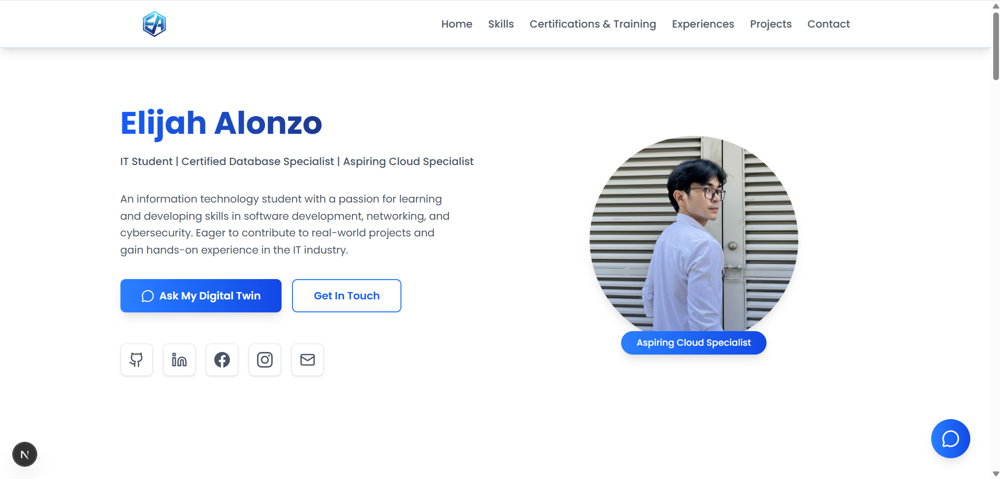
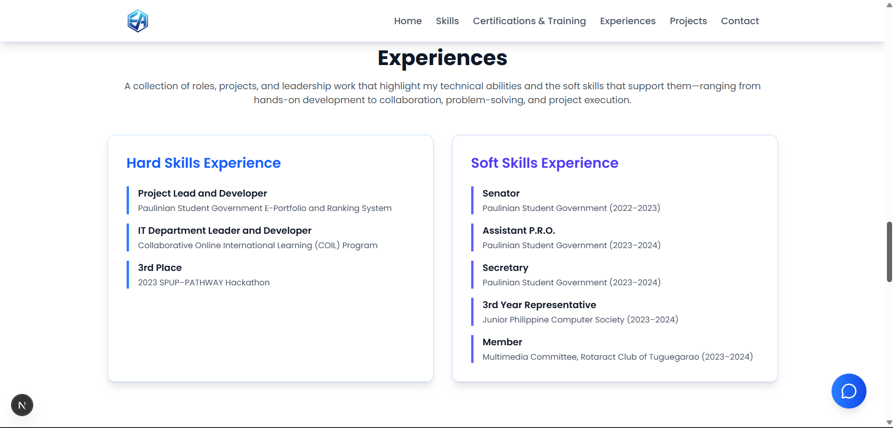
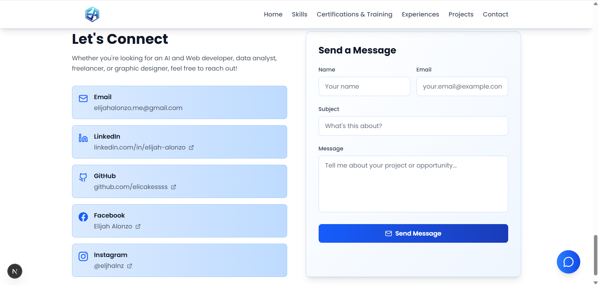
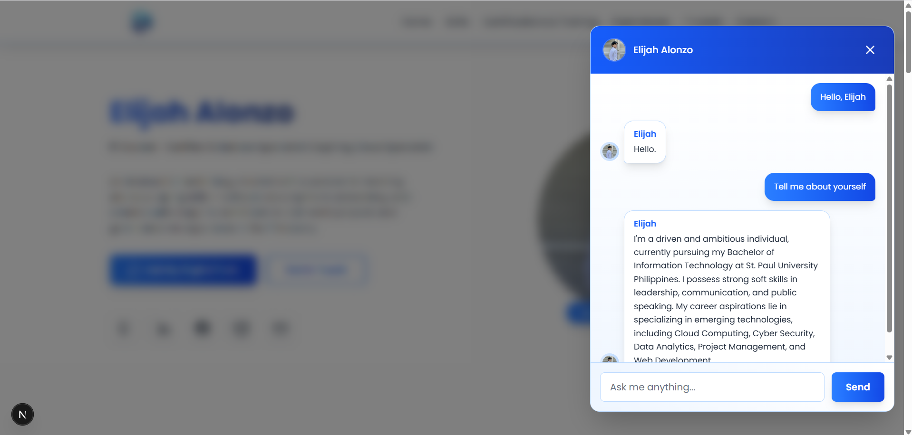

<h1 align="center">
    
AI Augmented Portfolio

</h1>

A personal portfolio showcasing my professional background, technical and professional skills, certifications, experience, and completed projects. The portfolio also features an AI chatbot that allows visitors to ask questions and receive answers based on information about my background, skills, experience, and projects, providing a more interactive way to explore my professional profile.



### Skills

The Skills section presents my technical and professional competencies, including programming languages, frameworks, tools, and soft skills. It gives visitors an overview of the areas I have experience in and the capabilities I bring to my work.


### Certifications & Training

The Certifications & Training section highlights my professional certifications, completed courses, and training programs. It provides evidence of my continued learning and the additional knowledge and skills I have developed beyond formal education.


### Experience

The Experience section presents my professional background, including previous roles, responsibilities, and notable achievements. It gives visitors a better understanding of my practical experience and how I have applied my skills in real-world settings.




### Projects

The Projects section showcases selected projects I have developed, including their purpose, key features, and technologies used. It demonstrates my ability to apply technical knowledge to solve problems and develop practical solutions.


### Contact

The Contact section provides visitors with ways to connect with me through my email and social media profiles. It serves as a direct point of contact for professional inquiries, opportunities, or further communication.



### AI Chatbot Feature

The AI Chatbot allows visitors to interact with an AI assistant that can answer questions about my background, skills, experience, certifications, and projects. It provides an interactive way for visitors to explore information about my portfolio beyond the static content presented throughout the website.



## Getting Started

```bash
npm install
cp .env.example .env.local   # then fill in the values
npm run dev
```

| Variable | Purpose |
| --- | --- |
| `GROQ_API_KEY` | LLM inference for the chatbot and MCP tools |
| `UPSTASH_VECTOR_REST_URL` / `UPSTASH_VECTOR_REST_TOKEN` | Vector search for chatbot retrieval |
| `NEXT_PUBLIC_WEB3FORMS_ACCESS_KEY` | Contact form delivery |

## Project Structure

```
app/            Routes: the page, layout, and API handlers (/api/rag, /api/mcp)
components/     UI, split into chat/, layout/, sections/, and shared ui/ primitives
config/         Site-wide constants
data/           Portfolio content (skills, projects, ...) and the digital twin profile
hooks/          Client-side state logic (chat, contact form)
lib/            Server logic: LLM client, RAG pipeline, MCP server, theme tokens
types/          Shared TypeScript types
docs/           Screenshots and example MCP client configuration
```

## MCP Server

The same profile data is exposed as a stateless [MCP](https://modelcontextprotocol.io) endpoint at `/api/mcp`, with two tools: `ask_digital_twin` and `get_profile_summary`. See `docs/claude_desktop_config.example.json` for a client configuration.
