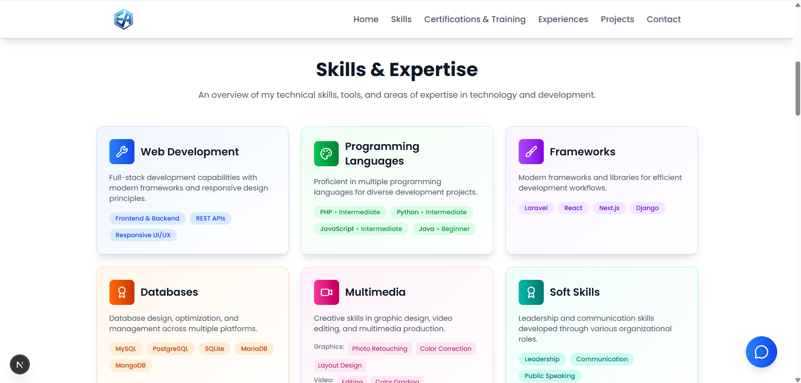
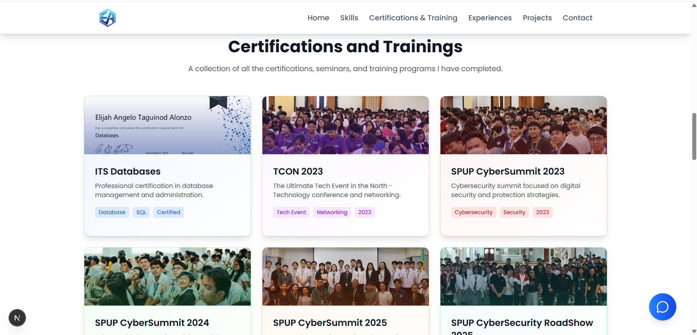
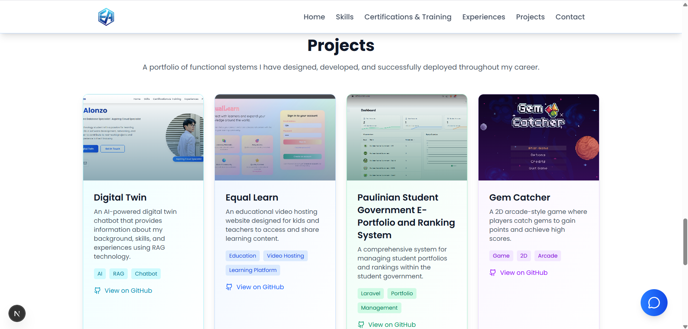

<h1 align="center">Retrieval Augmented Portfolio</h1>

A personal portfolio website developed to automate how I introduce myself to recruiters and clients, replacing a static résumé and back-and-forth emails with an interactive online profile. The system allows visitors to browse my skills, certifications, experience and projects, and gives them an AI assistant that answers their questions about my background right away, in their own words.

### Home

The Home section is the first thing visitors see: my name, title and a short introduction, with buttons to chat with my digital twin or get in touch, and links to my social profiles. It replaces sending a résumé and waiting for a reply with a page that tells visitors who I am and lets them reach me right away.

### Skills

The Skills section presents my technical and professional strengths, from programming languages and frameworks to design, video editing and soft skills. It replaces a long list on a résumé with grouped cards, so visitors can see at a glance what I can do and how comfortable I am with each programming language.

### Certifications and Training

The Certifications and Training section highlights the certifications I have earned and the conferences and seminars I have attended. It gathers proof of my continued learning in one place, so visitors don't have to ask for copies of certificates.

### Experience

The Experience section shows the roles I have held, both technical work and leadership in student government, along with the competitions I have placed in. It gives visitors a clear picture of how I have applied my skills in real settings.

### Projects

The Projects section showcases selected work, with a short description, the topics each project covers and a link to see more. It lets visitors judge my work directly instead of relying on a written summary.

### Contact

The Contact section lists every way to reach me and includes a message form, so visitors can get in touch without leaving the page or opening their email app. It makes it quick to turn interest into a conversation.

### AI Chatbot

The AI Chatbot lets visitors ask questions about my background, skills, experience and projects, and replies in my voice within seconds. It replaces waiting for an email reply or digging through the page with a simple conversation, available at any time.

